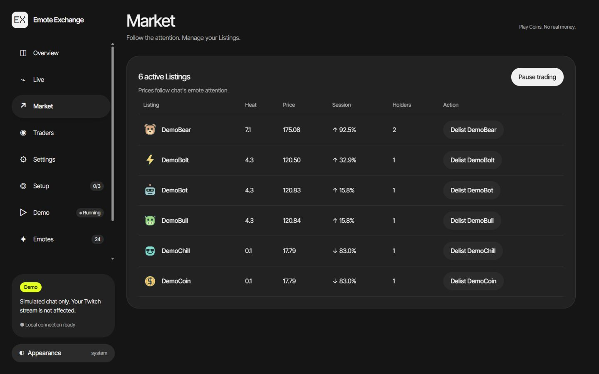
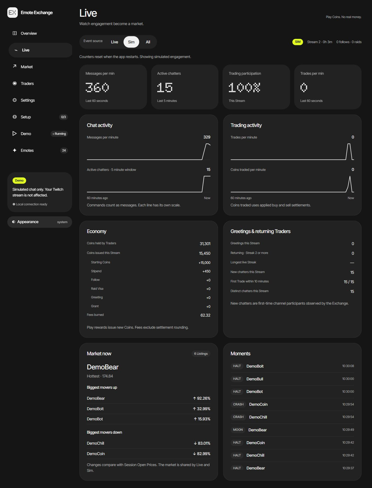
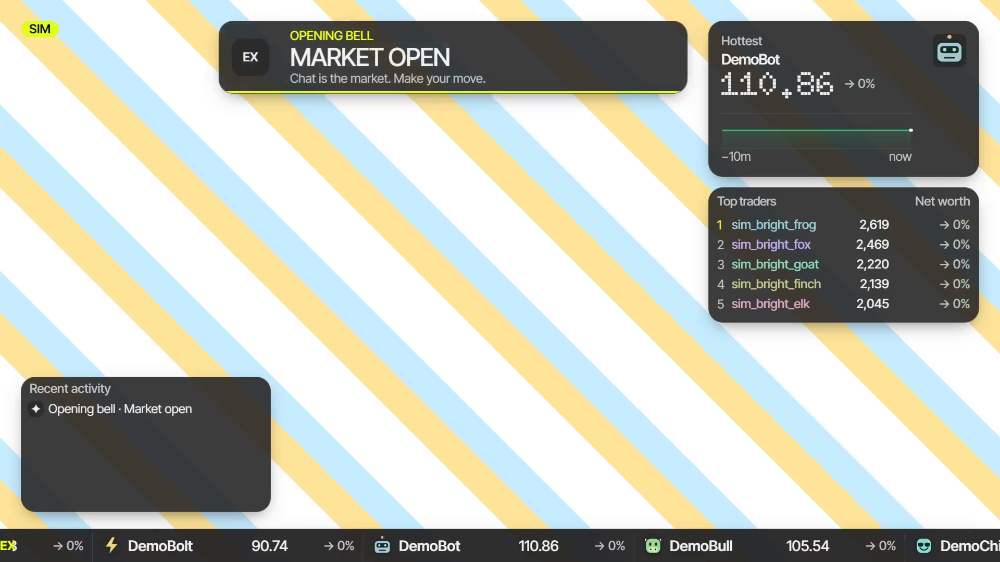

# Emote Exchange

Chat's attention becomes a play-money market. Two different chatters using an emote can list it; viewers buy and sell shares while its share of chat attention moves the Price. One local Node process serves the streamer's dashboard and a transparent OBS overlay. Coins have no cash value.

The market, dashboard controls, greetings and Streaks, broadcaster Grants and Live analytics are implemented. Automated checks and browser verification are recorded in the [hardening report](../../docs/verification/h4-hardening.md); actual OBS full/half-scale captures and measurements are in the [OBS report](../../docs/verification/h3-obs.md). Complete recorded live walkthroughs remain submission checks.



*Current production UI with simulated chat and Demo marked Running. These are demo results, not live-channel measurements.*

## Try it in three steps

1. Open a terminal at the **repository root**. Use Node **24.12+ within major 24** and **pnpm 11.25.0**. The workspace provisions Node 24.22.1 for its scripts.
2. Install and start:

   ```sh
   pnpm install --frozen-lockfile
   pnpm dev:exchange
   ```

3. Open [the dashboard](http://localhost:4100/), click **Start demo**, then open [the overlay](http://127.0.0.1:4100/overlay). Within a few seconds Opening day begins listing emotes. Leave the terminal running; stop it with Ctrl+C.

No `.env`, Twitch login or internet connection is required for the bundled demo. The app includes 24 original SVG emotes and local fonts. Optional public catalogs refresh in the background and cannot block startup. Installation needs registry access or an already populated package cache.

For production, stop the development process, then run from the repository root:

```sh
pnpm build
pnpm start:exchange
```

Both modes serve the same dashboard/overlay URLs. Only one process can use port 4100 at a time. Development reloads client edits; restart after server-code changes.

## A quick demo tour

Open **Demo**, choose a scenario and press **Start demo** (or **Start simulator** when Twitch is connected). Stop the current run before changing the scenario. Re-select a preset before starting it if you have navigated away from stopped demo controls.

| Scenario | What to watch |
|---|---|
| Opening day | Twelve chatters, six Listings and light trading. The Overview shortcut uses this preset. |
| Pump and dump | Early buys, concentrated attention, a Moon or Halt, then selling and falling attention over six minutes. Best started in a fresh market. |
| Greeting streak | Twelve chatters across four short Streams in 48 seconds; ten keep their Streaks and two skip the third Stream. |
| Solo spammer | Repeated Uses from one Chatter count less than Uses from a group. |
| Raid wave | A simulated 40-viewer Raid and twenty first-time chatters receiving Raid Visas. |
| Quiet market | Five minutes of sparse chat, followed by a closing Bell. |
| Soak | Forty minutes at 50 messages/sec, with a fixed pool of 500 chatters and 24 emotes. |
| Free play | Adjust rate, chatter count, seed and persona weights under Advanced. |

**Open bell**, **Close bell**, **Fake follow** and **Fake raid** are available while the simulator runs. A demo Open bell always begins a new Stream, so Streaks are easy to demonstrate. Close bell queues a local summary in **Chat → Would have said**. Stop generation with **Stop simulator**.

Demo and live events share the saved market. Simulation never sends messages to Twitch, even while connected. The SIM badge identifies an active simulator; stopping it preserves the simulated Traders and Holdings. To start fresh, use **Settings → Season reset** and type `RESET`; this clears the whole market, including live Portfolios. Use a fresh checkout for an isolated rehearsal if you want to preserve an existing market.

## Dashboard

| Page | What it does |
|---|---|
| Overview / Setup | Broadcaster/bot connection, overlay URL, setup checklist and local connection test. |
| Market | Heat, Price, session change and holder counts; Pause/Resume and confirmed Delist settlement. |
| Traders | Search, Coins, Net Worth, live Streak, Freeze/Unfreeze and a confirmed Grant form with quick amounts. |
| Settings | Starting Coins, Fee, trade cooldown, Heat half-life and maximum Grant; validated ranges, defaults and typed Season reset. |
| Live | Messages/min, five-minute active chatters, participation, Trades/min, sparklines, economy, greetings, movers and recent Moments. |
| Demo / Emotes / Chat / Diagnostics | Simulation controls, catalog samples, sent/dropped/local output, quiet mode and connection diagnostics. |

Live offers **Live / Sim / All** sources. It selects Live once eligible live activity arrives; Sim is labeled. Metrics update at most once a second while the page is open. Analytics counters reset on app restart; the saved market does not. Closing summaries compare with the median of recent completed live Streams after two exist. No viewer-count polling is implemented.



Catalog search and Show more operate on approved **samples**, not a complete provider catalog browser. CSV, backup import/export, portfolio overlay cards and sound cues are not implemented.

## Connect your Twitch channel

1. Register one application in the [Twitch developer console](https://dev.twitch.tv/console), with redirect URL **`http://localhost:4100/auth/callback`** and **Confidential** client type. See the [local setup guide](../../docs/setup-guide.md) for registration context.
2. Copy `apps/emote-exchange/.env.example` to `apps/emote-exchange/.env`. Fill `TWITCH_CLIENT_ID` and `TWITCH_CLIENT_SECRET`; keep `.env` private and git-ignored. Restart the app.
3. In **Setup**, connect the **Broadcaster** and approve `user:read:chat`, `user:write:chat` and `moderator:read:followers`. The optional **Bot** needs `user:write:chat`; use a separate account if you want to trade as the broadcaster, because the connected bot's messages are ignored as self-sent.
4. Confirm **EventSub connected** and five enabled subscriptions. Send a normal message from another account in the connected channel and check that the live event/chat counters rise.

Under **Chat**, **Send test message** explicitly sends “Emote Exchange connected” through the bot, otherwise the broadcaster. **Preview without sending** only adds a local preview. Quiet mode stops outbound sending and survives restart. Judge a live send by its **Sent** result, not just the button response.

Twitch, 7TV, BTTV and FFZ channel/global catalogs are cached and refreshed every 30 minutes. For a 7TV channel emote, assign a set to the connected Twitch channel, add the emote to it and press **Refresh emotes**. Uploading artwork alone does not enable a channel emote. `Cached` means the last good set remains after a failed refresh; `No channel set` means that provider needs setup.

The **Go live** checklist waits for a Twitch stream event. After a restart or gap, an already-running stream may show Unknown until another stream event arrives. Simulated bells do not mark Twitch online. Twitch cannot replay messages missed during a disconnected interval.

## Chat commands

Tickers use the emote name: exact case first, otherwise a unique case-insensitive match. A ticker must already be listed. Examples use bundled `DemoBull`; choose a current Listing from `!market` when testing live.

| Who | Command | Result |
|---|---|---|
| Everyone | `!buy DemoBull 1` / `!buy DemoBull max` | Buy a whole number of shares, including the Fee. |
| Everyone | `!sell DemoBull 1` / `!sell DemoBull all` | Sell immediately at the current Price. |
| Everyone | `!portfolio` or `!pf` | Coins, Holdings and Net Worth; appends the Streak while alive. |
| Everyone | `!market` / `!top` | Trading guidance and hottest tickers / top three Traders. |
| Everyone | `!greetings good morning` | Claim once per open Stream and build a Streak. The words are never retained, echoed or projected by the app. |
| Mod or broadcaster | `!market pause` / `!market resume` | Stop/resume Trades; Prices continue moving. |
| Mod or broadcaster | `!delist DemoBull` | Pay holders their whole-Coin Holding value without a Fee and remove the Listing. |
| Mod or broadcaster | `!freeze @name` / `!unfreeze @name` | Stop/restore one existing Trader's trading. |
| Broadcaster only | `!grant @name 500` | Give an existing Trader Coins within the configured maximum. Mods cannot grant. |

Replies share a budget of one per Trader per 20 seconds and a queue capped at one send/sec and 18 per rolling 30 seconds. A missing reply does not reverse an accepted Trade or reward: check the Feed or Traders page. Unknown commands are ignored so other bots can coexist.

## Fairness and defaults

- **Play money only:** no deposits, withdrawals or real-money redemption. Coins are integers capped at 1,000,000,000 per Trader; rewards record the amount actually credited.
- **Attention moves Prices:** two distinct chatters can IPO at 100.00. Repeating an emote within 30 seconds earns progressively less Heat. Commands, app echoes and foreign shared-chat messages add no Heat. At most 24 Listings are active.
- **Trades settle immediately:** default Fee 1% with a one-Coin minimum; buy debits round up and sell credits round down. Default cooldown three seconds; quantity cap 1,000,000. Insufficient Coins/shares, Pause, Freeze and Halts reject the Trade.
- **Rewards create Coins:** default starting Coins 1,000; Stipend 10 per qualifying chat minute; Follow 200; Raid Visa 500 for first-time chatters within five minutes of a Raid. Coins are not conserved.
- **Greetings:** 50 Coins initially, +10 per consecutive Stream, capped at 140 from Streak 10. A skipped whole Stream breaks the Streak. Live opening Bells less than two hours after the previous end continue the Stream; demo Open always starts a new one. Frozen Traders and closed Stream Sessions cannot claim.
- **Grants:** default maximum 10,000 Coins, broadcaster-only, with durable request deduplication. No Fee, Trade, Heat or Price effect.
- **Bells are ceremony:** ordinary trading remains available after Close bell; greetings require an open Stream Session. Mods can Pause, Freeze or Delist. A Season reset clears Portfolios and Streaks.

The [Exchange spec](../../docs/specs/emote-exchange.md) and [engine tests](test/) contain the formulas and boundary cases.

## OBS Browser Source

| Setting | Value |
|---|---|
| URL | `http://127.0.0.1:4100/overlay` |
| Width × height | **1920 × 1080** |
| Use custom frame rate | **On, 60 FPS**; set OBS Video FPS to **60** too |
| Background | Transparent |
| Source context menu → Blending Method | **SRGB Off** |
| Shutdown source when not visible | **Off** |
| Refresh browser when scene becomes active | **Off** |

Tape, Chart, top-five Board, Feed, queued Banners and the simulator badge sit above your footage. Use `?motion=reduced` for reduced motion, `?widgets=chart,board` to select widgets, or combine them with `&`. `sound=off` is accepted, but this build has no sound playback.

Use the Browser Source's **Blending Method → SRGB Off** so the translucent panels keep their browser appearance. In the OBS 33 bright-scene check, Default blending made the backing visibly lighter; SRGB Off restored the intended dark glass. This is a source setting, separate from OBS's global video color settings.



Check full size and 50% scale over bright and dark scenes. An overlay preview tab completes the dashboard's overlay-connected step; that does **not** verify OBS rendering or 60 fps. Browser screenshots and OBS performance are separate checks.

## Data, privacy and recovery

SQLite lives at `apps/emote-exchange/data/emote-exchange.sqlite`; migrations run on startup. `DATA_DIR` overrides the location, with relative paths resolved from the app directory. Tokens stay server-only in this git-ignored database. Raw incoming chat stays server-side; public snapshots/SSE contain approved display data, not chat text or credentials. The server binds only to `127.0.0.1`; actions require same-origin requests and the `X-CTA` guard, with no CORS.

Portfolios, settings, Stream numbers and Streaks survive restart. Socket connections, simulator generation, analytics counters and queued chat do not replay. Browsers reconnect automatically. During a gap they show the last state and disable unsafe dashboard actions. Short downtime decays Heat/impact without inventing rewards; downtime of ten minutes or more clears stale Heat/impact and retains Portfolios.

Treat the entire data directory as private because it contains tokens. Season reset clears the whole market, not only simulation. There is no in-app backup/import feature.

## Checks

Run from the repository root:

```sh
pnpm check
pnpm lint
pnpm test
pnpm build
pnpm smoke
```

The suite currently contains **184 tests**, including ten deployment-readiness checks alongside deterministic price fixtures, exact settlement, auth/protocol failures, hosted authorization, Turso durability, guarded routes, greetings/Grants, analytics and a 40-minute virtual Soak. The Soak makes the full run take several minutes on some machines. Production smoke uses temporary data and checks actual process restart, SSE, demo behavior and preserved Portfolios. For Render configuration and its separate live acceptance gates, see [Render deployment](../../docs/render-deployment.md).

## Troubleshooting

| Symptom | What to check |
|---|---|
| Unsupported Node / TypeScript won't start | Use Node 24.12+ within major 24 and pinned pnpm. The frozen install above provisions the workspace runtime. |
| Port busy | Stop the previous process. For a different port, set matching `PORT` and `PUBLIC_ORIGIN` in `.env` and register that exact callback. |
| “Client build missing” | Run `pnpm build` before `pnpm start:exchange`. |
| Empty overlay | Start Opening day, wait for two chatters to use an emote, then check Market. The center is intentionally transparent. |
| No live chat / Unknown stream | Check broadcaster auth and five subscription states. A stream already online may not emit another opening event. Missed events are not replayed. |
| Login fails / client becomes Public | This app needs a confidential client with a secret. Check both `.env` values and exact callback/public origin; restart after changes. |
| Your own messages don't trade | Bot-account messages and recent app echoes are self-sent and ignored. Use another test account. Foreign shared-chat messages are ignored too. |
| Command has no reply | Wait 20 seconds for that Trader's budget, check quiet mode and Chat diagnostics, and confirm the ticker is listed and not halted. |
| Greeting pays nothing | It needs words, an open Stream Session, an unfrozen Trader and no previous claim this Stream. Another short live Session can continue the same Stream. |
| Demo numbers remain after Stop | Stop halts generation; saved Portfolios remain. Review the Season reset warning before clearing them. |
| Disconnect / Reconnecting | Keep the server running; SSE/EventSub reconnect automatically. For storage errors, stop, check writable space/directory access and restart. Failed writes deliver no success effects. |
| Analytics empty after restart | Counters deliberately restart empty; open a Stream Session and generate activity. Saved Portfolios and Streaks remain. |
| Provider emote missing | Enable it in the channel's active set and Refresh emotes. Names are case-sensitive; failures use cached data. |

## Architecture and build evidence

React/Vite render the dashboard and overlay. Hono serves loopback HTTP, native SQLite stores state, EventSub WebSocket receives events, Helix sends through one bounded queue, and SSE publishes explicit browser projections. Pure market/protocol engines take injected time and return effects; runtime code owns I/O. No chart library or hosted backend is required.

- [Twitch Kit spec](../../docs/specs/twitch-kit.md) · [Exchange spec](../../docs/specs/emote-exchange.md) · [ADRs](../../docs/adr/) · [glossary](GLOSSARY.md).
- Actual implementation/test evidence: [price fixtures](../../docs/verification/e0-behavior-fixtures.md), [runtime recovery and live buy](../../docs/verification/e3-runtime-and-recovery.md), [dashboard](../../docs/verification/e5-dashboard.md), [scenario/Soak results](../../docs/verification/e6-scenarios.md), [H4 hardening](../../docs/verification/h4-hardening.md) and [H6 README verification](../../docs/verification/h6-readme.md).
- E7–E9 tests and visual verification are recorded in their individual Git commit bodies. H4 records the real production-smoke failure (`8 !== 7`), its fix and passing verification. These are actual Codex build artifacts; they do not claim hosted CI, a recorded OBS walkthrough or a completed submission.
