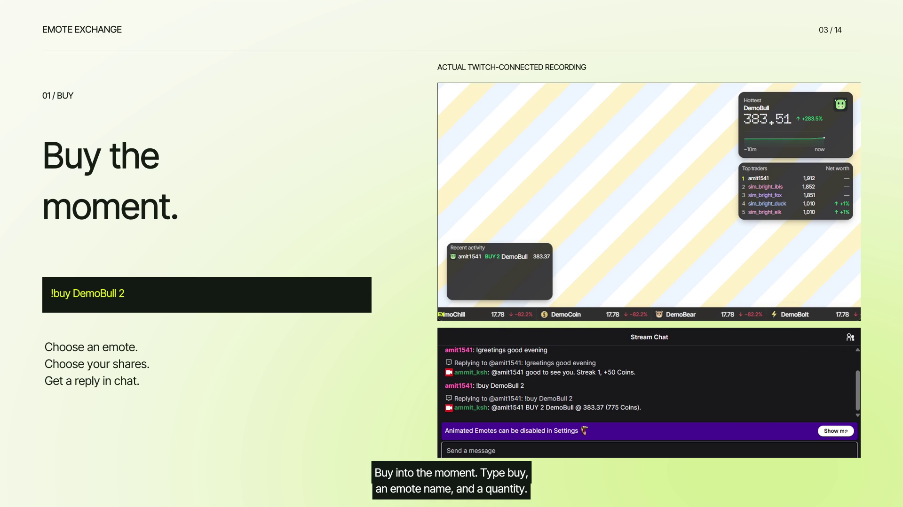

# Emote Exchange — demo video package

Prepared November 1, 2026. The videos below are finished local files. A public Emote Exchange YouTube URL has not yet been supplied or recorded.

## Choose the video

| Video | Duration | Voice | Use |
|---|---|---|---|
| [Launch teaser](media/emote-exchange-teaser.mp4) | 0:34 | Sarah | Short launch-style introduction with real demo clips |
| [App feature tour](media/emote-exchange-launch.mp4) | 1:41 | Sarah | Separate commands, check-ins, Streaks, Grants, rewards and dashboard chapters |
| [Hackathon walkthrough](media/emote-exchange-devpost.mp4) | 2:05 | George | Twitch functionality plus actual Codex planning/source/review evidence |

The Sarah videos follow the requested app-only direction, using original cream/lime titles, a striped overlay background and real Twitch chat. The 2:05 walkthrough also contains the build footage requested by the [hackathon rules](https://twitchcon-codex.devpost.com/rules), checked November 1. Those rules request a video under three minutes with Twitch functionality and Codex build footage, hosted publicly on YouTube. Keep that distinction when selecting the submission's primary video.

[](media/emote-exchange-launch.mp4)

## Sarah feature-tour upload

### YouTube title

Emote Exchange | Chat Is the Market | Narration: elevenlabs.io

### YouTube description

Turn your Twitch community's emotes into a live market. Buy and sell shares with free play Coins, check in each Stream, build a Streak and follow the leading Traders.

This app-only demo shows actual Twitch chat commands, bot replies, the streamer dashboard and the OBS overlay over a striped background. Watch a successful buy, Portfolio check, sell and a confirmed 500-Coin streamer Grant. The footage was recorded locally while connected to Twitch; it is not presented as a public broadcast.

Check in with `!greetings` followed by a few words. The reward can be claimed once per open Stream, starting at 50 Coins and increasing with consecutive-Stream Streaks up to 140. Default rewards also include 1,000 starting Coins, a 10-Coin Stipend per qualifying chat minute, a 200-Coin Follow bonus and a 500-Coin Raid Visa for eligible first-time Chatters. Coins have no cash value.

Source: https://github.com/amit-ksh/emote-exchange

Setup: https://github.com/amit-ksh/emote-exchange/blob/main/apps/emote-exchange/README.md

Synthetic English narration: Sarah — Mature, Reassuring, Confident, ElevenLabs. Attribution: https://elevenlabs.io/

### Chapters

```text
00:00 A game for your chat
00:08 Meet Emote Exchange
00:17 Buy
00:25 Sell
00:31 Portfolio
00:38 Check in and build a Streak
00:51 Broadcaster Grants
01:02 Market commands
01:06 Top Traders
01:11 Earn Coins
01:21 Streamer controls
01:25 Live analytics
01:30 Command reference
```

### Captions and thumbnail

- Feature tour: [English SRT](media/emote-exchange-launch.srt)
- Short launch cut: [English SRT](media/emote-exchange-teaser.srt)
- Thumbnail: [actual buy interaction](media/launch-poster.png)
- Script: [Sarah voiceover and command examples](launch-narration.md)

## Hackathon walkthrough upload

Use [video-publishing.md](video-publishing.md) for the 2:05 walkthrough's title, description, chapter times and George narration credit. Its companion files are [English SRT](media/emote-exchange-devpost.srt) and [thumbnail](media/devpost-poster.png).

## Before pasting the demo URL into Devpost

1. Choose the primary cut, accounting for the organizer's requested Codex build footage.
2. Resolve the narration usage rights described in [publishing notes](video-publishing.md). The account reported the free tier; a commercial audio license is not claimed. Preserve `elevenlabs.io` in the publishing title.
3. Upload the selected Emote Exchange video to YouTube with public visibility, then check logged-out playback, audio and captions.
4. Paste that public URL into the demo-video field in [devpost-submission.md](devpost-submission.md).
5. Confirm judges can access the source repository. A private repository needs the organizer access described in the official rules.

No upload, Devpost submission or judge-access change is performed by creating these Markdown files. The supplied Ion URL is a style reference, not the Emote Exchange demo URL.

## Recording and export evidence

- [Real greeting, Trade, Grant and command verification](../verification/v1-launch-video.md)
- [Sarah exports, hashes, captions and frame counts](media/launch-audit.json)
- [Earlier hackathon walkthrough verification](../verification/v1-live-video.md)
